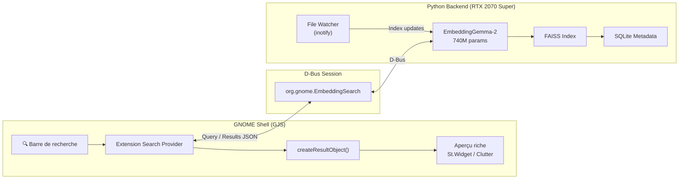
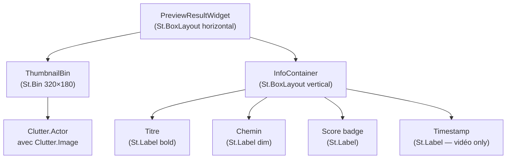

# 🔍 GnomeSearch Embedding — Plan d'implémentation complet

## Vue d'ensemble

Remplacer le moteur de recherche textuel de GNOME par un système de **recherche sémantique multimodale** basé sur **EmbeddingGemma-2** de Google. Le système permet des requêtes en langage naturel comme _"zèbre dans une vidéo"_ et retourne directement le fichier avec un aperçu riche (grand format, timestamp vidéo, etc.) intégré dans GNOME Shell.



---

## ⚙️ Environnement détecté

| Composant               | Valeur                     |
| ----------------------- | -------------------------- |
| **OS**                  | Fedora 44                  |
| **GNOME Shell**         | 50.5 (ES modules)          |
| **Python**              | 3.14.8                     |
| **GPU 0 (main)**        | RTX 2080 Ti — 11 GB VRAM   |
| **GPU 1 (embedding)**   | RTX 2070 Super — 8 GB VRAM |
| **CUDA**                | 13.4                       |
| **FFmpeg**              | 8.1.3                      |
| **Espace disque libre** | ⚠️ 8.4 GB sur `/home`      |

> [!CAUTION]
> **Seulement 8.4 GB libres** sur `/home`. Le modèle complet (~2 GB), le venv (~2 GB), et l'index vectoriel tiendront mais il faut optimiser. **Il est fortement recommandé de libérer de l'espace ou de monter un stockage externe avant de commencer.** L'utilisation de Matryoshka 256d au lieu de 768d réduit l'index de ~66%.

---

## 🏗️ Architecture du projet

### Structure des fichiers

```
GnomeSearch_Embedding/
├── .env                              # Configuration GPU, chemins, options
├── .env.example                      # Template de configuration
├── README.md
├── setup.sh                          # Script d'installation automatique
│
├── backend/                          # 🐍 Python Backend (Service D-Bus)
│   ├── requirements.txt
│   ├── service.py                    # Point d'entrée — D-Bus service + GLib MainLoop
│   ├── config.py                     # Chargement .env, constantes
│   ├── model.py                      # Chargement EmbeddingGemma-2, encodage
│   ├── indexer.py                    # Indexation des fichiers (texte, images, vidéos, audio)
│   ├── searcher.py                   # Recherche sémantique FAISS
│   ├── watcher.py                    # File watcher (inotify) pour mise à jour en temps réel
│   ├── video_processor.py            # Extraction de frames vidéo + timestamps
│   ├── thumbnail_generator.py        # Génération de thumbnails pour les résultats
│   ├── db.py                         # SQLite — métadonnées des fichiers indexés
│   └── dbus_interface.xml            # Définition interface D-Bus
│
├── extension/                        # 🖥️ Extension GNOME Shell
│   ├── metadata.json
│   ├── extension.js                  # Point d'entrée, enable/disable
│   ├── searchProvider.js             # SearchProvider2 avec createResultObject()
│   ├── previewWidget.js              # Widgets d'aperçu riches (St/Clutter)
│   ├── dbusClient.js                 # Proxy D-Bus vers le backend Python
│   ├── utils.js                      # Helpers (formatage, icônes)
│   └── stylesheet.css                # Styles des aperçus riches
│
├── systemd/                          # 🔧 Service systemd utilisateur
│   └── gnome-embedding-search.service
│
└── data/                             # 📦 Données runtime (gitignored)
    ├── index/                        # FAISS index files
    ├── metadata.db                   # SQLite database
    └── thumbnails/                   # Cache de thumbnails générés
```

---

## 📐 Phase 1 — Backend Python (Service d'embedding)

### 1.1 Configuration & environnement

**`.env`** — Permet de choisir le GPU et configurer le système :

```bash
# GPU Configuration
CUDA_VISIBLE_DEVICES=1                    # RTX 2070 Super (index 1)
EMBEDDING_DEVICE=cuda:0                   # Après masquage, devient cuda:0
TORCH_DTYPE=float32                       # float32 ou bfloat16 (PAS float16 !)

# Model Configuration
MODEL_ID=google/embeddinggemma-2
EMBEDDING_DIM=256                         # Matryoshka: 128, 256, 512, ou 768
MODALITY=multimodal                       # text_only | text_vision | text_audio | multimodal
BATCH_SIZE=16                             # Batch size pour l'encodage

# Indexing Configuration
WATCH_DIRS=/home/swanlepeltier/Documents,/home/swanlepeltier/Videos,/home/swanlepeltier/Pictures,/home/swanlepeltier/Music
INDEX_PATH=/home/swanlepeltier/Documents/GitHub/GnomeSearch_Embedding/data/index
DB_PATH=/home/swanlepeltier/Documents/GitHub/GnomeSearch_Embedding/data/metadata.db
THUMBNAIL_PATH=/home/swanlepeltier/Documents/GitHub/GnomeSearch_Embedding/data/thumbnails

# Video Processing
VIDEO_FRAME_INTERVAL=3                    # Extraire 1 frame toutes les 3 secondes
VIDEO_EXTENSIONS=.mp4,.mkv,.avi,.webm,.mov
IMAGE_EXTENSIONS=.jpg,.jpeg,.png,.webp,.bmp,.gif,.tiff
AUDIO_EXTENSIONS=.mp3,.flac,.wav,.ogg,.m4a
TEXT_EXTENSIONS=.txt,.md,.pdf,.docx,.py,.js,.rs,.c,.cpp,.h,.json,.yaml,.toml,.csv

# D-Bus
DBUS_BUS_NAME=org.gnome.EmbeddingSearch
DBUS_OBJECT_PATH=/org/gnome/EmbeddingSearch

# Performance
MAX_RESULTS=8                             # Nombre max de résultats retournés
SEARCH_TIMEOUT_MS=500                     # Timeout de recherche en ms
```

### 1.2 Modèle — `model.py`

```python
# Chargement modulaire d'EmbeddingGemma-2
# - text_only (270M, <2 GB VRAM) pour les fichiers texte
# - text_vision (440M, ~2 GB) pour images + vidéo frames
# - multimodal (740M, ~2 GB) pour tout inclure
#
# Utilise sentence-transformers pour la simplicité
# Matryoshka truncation à 256d pour économiser l'espace disque
```

> [!IMPORTANT]
> **Ne JAMAIS utiliser `torch.float16`** — le modèle produit des NaN. Utiliser `torch.bfloat16` (si supporté) ou `torch.float32`.
> La RTX 2070 Super (Turing) ne supporte pas Flash Attention 2 mais ça fonctionne parfaitement sans.

### 1.3 Indexation — `indexer.py`

L'indexeur traite 4 types de contenu :

| Type      | Méthode d'embedding                | Métadonnées stockées                                |
| --------- | ---------------------------------- | --------------------------------------------------- |
| **Texte** | Contenu textuel → encodeur texte   | chemin, nom, taille, date modif, extrait            |
| **Image** | Pixels → encodeur vision           | chemin, nom, dimensions, EXIF                       |
| **Vidéo** | Frames extraites → encodeur vision | chemin, nom, durée, **timestamp de chaque frame**   |
| **Audio** | Segments audio → encodeur audio    | chemin, nom, durée, **timestamp de chaque segment** |

**Stratégie d'indexation vidéo :**

1. Extraire 1 frame toutes les N secondes via FFmpeg/cv2
2. Encoder chaque frame avec l'encodeur vision
3. Stocker le vecteur + `(video_path, timestamp_sec)` dans FAISS + SQLite
4. Générer un thumbnail pour chaque frame (taille réduite, stocké sur disque)

### 1.4 Recherche — `searcher.py`

```python
# Pipeline de recherche :
# 1. Encoder la requête texte avec l'encodeur texte
# 2. Recherche cosine similarity dans FAISS (IndexFlatIP)
# 3. Récupérer les métadonnées depuis SQLite (chemin, type, timestamp, etc.)
# 4. Retourner JSON trié par score :
#    [
#      {
#        "id": "video:/home/user/Videos/safari.mp4@42.5",
#        "type": "video",
#        "path": "/home/user/Videos/safari.mp4",
#        "name": "safari.mp4",
#        "score": 0.87,
#        "timestamp": 42.5,
#        "thumbnail_path": "/path/to/thumbnail.jpg",
#        "description": "Vidéo • 1:23:45 • à 0:42"
#      },
#      ...
#    ]
```

### 1.5 File Watcher — `watcher.py`

- Utilise `inotify` (via `watchdog` ou `inotify_simple`) pour surveiller les répertoires configurés
- Déclenche l'indexation/suppression automatique quand un fichier est créé/modifié/supprimé
- File d'attente avec debounce (500ms) pour éviter les indexations multiples
- Réindexation complète au démarrage si des fichiers ont changé

### 1.6 Interface D-Bus — `service.py`

```xml
<!-- dbus_interface.xml -->
<node>
  <interface name="org.gnome.EmbeddingSearch">
    <!-- Recherche sémantique -->
    <method name="Search">
      <arg type="s" name="query" direction="in"/>
      <arg type="u" name="max_results" direction="in"/>
      <arg type="s" name="results_json" direction="out"/>
    </method>

    <!-- État du service -->
    <method name="GetStatus">
      <arg type="s" name="status_json" direction="out"/>
    </method>

    <!-- Réindexation manuelle -->
    <method name="Reindex">
      <arg type="b" name="full" direction="in"/>
    </method>

    <!-- Signaux -->
    <signal name="IndexingProgress">
      <arg type="u" name="processed"/>
      <arg type="u" name="total"/>
    </signal>

    <signal name="IndexingComplete"/>
  </interface>
</node>
```

### 1.7 Service systemd utilisateur

```ini
# systemd/gnome-embedding-search.service
[Unit]
Description=GNOME Embedding Search Backend
After=graphical-session.target

[Service]
Type=dbus
BusName=org.gnome.EmbeddingSearch
ExecStart=/home/swanlepeltier/Documents/GitHub/GnomeSearch_Embedding/.venv/bin/python \
          /home/swanlepeltier/Documents/GitHub/GnomeSearch_Embedding/backend/service.py
Environment=CUDA_VISIBLE_DEVICES=1
EnvironmentFile=/home/swanlepeltier/Documents/GitHub/GnomeSearch_Embedding/.env
Restart=on-failure
RestartSec=5

[Install]
WantedBy=default.target
```

> [!TIP]
> Le service systemd utilisateur (`--user`) démarre automatiquement à la connexion et garde le modèle chargé en permanence sur la RTX 2070 Super. Latence de recherche : **< 50ms** après le premier chargement.

---

## 🖥️ Phase 2 — Extension GNOME Shell

### 2.1 Metadata

```json
{
  "uuid": "embedding-search@gnome-search-embedding",
  "name": "Semantic Embedding Search",
  "description": "Recherche sémantique multimodale propulsée par EmbeddingGemma-2",
  "shell-version": ["50"],
  "version": 1,
  "url": "https://github.com/swanlepeltier/GnomeSearch_Embedding"
}
```

### 2.2 Search Provider — `searchProvider.js`

Le provider s'enregistre dans le système de recherche GNOME et communique avec le backend Python via D-Bus :

```javascript
// Méthodes clés du SearchProvider :

async getInitialResultSet(terms) {
    // 1. Joindre les termes en une requête
    // 2. Appeler le backend D-Bus : proxy.SearchRemote(query, maxResults)
    // 3. Parser le JSON retourné
    // 4. Retourner les IDs des résultats
}

getResultMetas(ids) {
    // Retourner les métadonnées (nom, description, icône) pour chaque résultat
    // Les données sont déjà en cache depuis getInitialResultSet
}

createResultObject(meta) {
    // ⭐ C'est ICI que la magie opère
    // Retourner un widget St/Clutter personnalisé avec :
    //   - Grand aperçu (image/frame vidéo) au lieu du petit thumbnail GNOME
    //   - Titre du fichier
    //   - Score de pertinence
    //   - Pour les vidéos : timestamp formaté "à 0:42"
    //   - Barre de progression pour les vidéos
    return new PreviewResultWidget(meta);
}

activateResult(id) {
    // Ouvrir le fichier avec l'application par défaut
    // Pour les vidéos : ouvrir au timestamp exact (xdg-open + paramètre)
}
```

### 2.3 Widget d'aperçu riche — `previewWidget.js`



**Tailles d'aperçu :**

- **Vidéo** : 320×180 px (16:9) — affiche la frame au timestamp trouvé
- **Image** : 320×auto (proportionnel) — affiche l'image redimensionnée
- **Audio** : 64×64 icône + forme d'onde simplifiée
- **Texte** : 48×48 icône + extrait de contenu

**Chargement des thumbnails :**

1. Le backend génère et cache les thumbnails sur disque
2. Le path du thumbnail est passé dans le JSON D-Bus
3. L'extension charge le thumbnail via `GdkPixbuf.Pixbuf.new_from_file_at_scale()` → `Clutter.Image`
4. Fallback sur les thumbnails GNOME existants (`~/.cache/thumbnails/`) si disponibles

### 2.4 Activation des résultats vidéo

Quand l'utilisateur clique sur un résultat vidéo :

```javascript
activateResult(id) {
    // Parser l'ID : "video:/path/to/video.mp4@42.5"
    const [type, pathAndTs] = id.split(':');
    const [filePath, timestamp] = pathAndTs.split('@');

    if (type === 'video' && timestamp) {
        // Ouvrir avec le player vidéo au timestamp exact
        // Option 1: mpv (supporte --start=)
        GLib.spawn_command_line_async(
            `mpv --start=${timestamp} "${filePath}"`
        );
        // Option 2: VLC
        // GLib.spawn_command_line_async(
        //     `vlc --start-time=${timestamp} "${filePath}"`
        // );
    } else {
        // Fichier normal : ouvrir avec l'app par défaut
        Gio.AppInfo.launch_default_for_uri(
            GLib.filename_to_uri(filePath, null), null
        );
    }
}
```

### 2.5 Stylesheet — `stylesheet.css`

```css
/* Widget principal */
.embedding-search-result {
  padding: 10px;
  border-radius: 12px;
  margin: 4px 0;
  transition-duration: 150ms;
}
.embedding-search-result:hover {
  background-color: rgba(255, 255, 255, 0.08);
}

/* Thumbnail grand format */
.embedding-search-thumbnail {
  border-radius: 8px;
  background-color: rgba(0, 0, 0, 0.3);
  margin-right: 14px;
  border: 1px solid rgba(255, 255, 255, 0.1);
}

/* Badge de score */
.embedding-score-badge {
  background-color: rgba(98, 160, 234, 0.3);
  border-radius: 6px;
  padding: 2px 8px;
  font-size: 9pt;
  color: #62a0ea;
}

/* Timestamp vidéo */
.embedding-timestamp {
  background-color: rgba(255, 163, 72, 0.25);
  border-radius: 4px;
  padding: 2px 6px;
  font-size: 9pt;
  color: #ffa348;
}
```

---

## 🚀 Phase 3 — Installation & déploiement

### 3.1 Script d'installation — `setup.sh`

```bash
#!/bin/bash
# 1. Créer le venv Python
# 2. Installer les dépendances (torch, sentence-transformers, faiss-gpu, etc.)
# 3. Télécharger le modèle EmbeddingGemma-2
# 4. Créer le fichier .env depuis .env.example
# 5. Installer le service systemd utilisateur
# 6. Installer l'extension GNOME Shell
# 7. Lancer l'indexation initiale
```

### 3.2 Dépendances Python — `requirements.txt`

```
torch>=2.4.0
sentence-transformers>=3.0.0
transformers>=4.45.0
accelerate>=0.34.0
faiss-cpu>=1.8.0              # ou faiss-gpu si CUDA compilé
numpy
Pillow
opencv-python-headless        # Pour l'extraction de frames vidéo
pydbus                        # D-Bus Python bindings
watchdog                      # File system watcher
python-dotenv                 # Chargement .env
```

> [!NOTE]
> On utilise `faiss-cpu` par défaut car la recherche dans l'index est très rapide même sur CPU (< 5ms pour 100k vecteurs en 256d). Le GPU est réservé exclusivement à l'encodage des embeddings.

---

## 📋 Plan d'exécution par phases

### Phase 1 — Backend core _(~3-4 sessions)_

| Étape | Tâche                                                     | Priorité     |
| ----- | --------------------------------------------------------- | ------------ |
| 1.1   | Setup venv, `.env`, `config.py`                           | 🔴 Critique  |
| 1.2   | `model.py` — Chargement EmbeddingGemma-2 sur GPU 1        | 🔴 Critique  |
| 1.3   | `db.py` — Schema SQLite pour métadonnées                  | 🔴 Critique  |
| 1.4   | `indexer.py` — Indexation texte (fichiers texte simples)  | 🔴 Critique  |
| 1.5   | `searcher.py` — Recherche FAISS basique                   | 🔴 Critique  |
| 1.6   | `service.py` — Service D-Bus minimal (Search + GetStatus) | 🔴 Critique  |
| 1.7   | Test E2E : indexer un dossier, chercher via D-Bus         | 🟡 Important |

### Phase 2 — Extension GNOME Shell _(~2-3 sessions)_

| Étape | Tâche                                                    | Priorité     |
| ----- | -------------------------------------------------------- | ------------ |
| 2.1   | `metadata.json` + `extension.js` (enable/disable)        | 🔴 Critique  |
| 2.2   | `dbusClient.js` — Proxy D-Bus async                      | 🔴 Critique  |
| 2.3   | `searchProvider.js` — Provider basique (résultats texte) | 🔴 Critique  |
| 2.4   | `previewWidget.js` — Widget d'aperçu riche               | 🟡 Important |
| 2.5   | `stylesheet.css` — Styles des aperçus                    | 🟡 Important |
| 2.6   | Test E2E : recherche dans GNOME Shell Overview           | 🟡 Important |

### Phase 3 — Multimodal _(~2-3 sessions)_

| Étape | Tâche                                                 | Priorité        |
| ----- | ----------------------------------------------------- | --------------- |
| 3.1   | `indexer.py` — Indexation images (encodeur vision)    | 🟡 Important    |
| 3.2   | `video_processor.py` — Extraction frames + timestamps | 🟡 Important    |
| 3.3   | `indexer.py` — Indexation vidéo (frames → embeddings) | 🟡 Important    |
| 3.4   | `thumbnail_generator.py` — Génération thumbnails      | 🟡 Important    |
| 3.5   | `previewWidget.js` — Aperçu vidéo avec timestamp      | 🟡 Important    |
| 3.6   | Activation vidéo au timestamp (mpv/vlc)               | 🟢 Nice-to-have |

### Phase 4 — Production _(~1-2 sessions)_

| Étape | Tâche                                          | Priorité        |
| ----- | ---------------------------------------------- | --------------- |
| 4.1   | `watcher.py` — File watcher temps réel         | 🟡 Important    |
| 4.2   | Service systemd utilisateur (auto-start)       | 🟡 Important    |
| 4.3   | `setup.sh` — Script d'installation automatique | 🟢 Nice-to-have |
| 4.4   | Gestion d'erreurs robuste, logging             | 🟢 Nice-to-have |
| 4.5   | Indexation audio (si temps)                    | 🟢 Nice-to-have |

---

## 💾 Estimation d'espace disque

| Composant                             | Taille estimée |
| ------------------------------------- | -------------- |
| Python venv + dépendances             | ~2.0 GB        |
| Modèle EmbeddingGemma-2 (cache HF)    | ~1.5 GB        |
| FAISS Index (10k fichiers, 256d)      | ~10 MB         |
| FAISS Index (100k frames vidéo, 256d) | ~100 MB        |
| SQLite metadata                       | ~5 MB          |
| Thumbnails cache                      | ~200 MB        |
| **Total estimé**                      | **~3.8 GB**    |

> [!WARNING]
> Avec 8.4 GB libres, il reste ~4.6 GB après installation. C'est serré. Recommandations :
>
> - Nettoyer les caches (`pip cache purge`, `~/.cache/huggingface/` unused models)
> - Utiliser `truncate_dim=256` (au lieu de 768) pour réduire l'index de 66%
> - Limiter les répertoires surveillés aux dossiers essentiels
> - Envisager un disque externe ou un symlink du cache HuggingFace vers un autre volume

---

## 🔑 Décisions techniques clés

### Pourquoi EmbeddingGemma-2 est parfait ici

1. **Espace vectoriel partagé** — texte, images, et audio vivent dans le même espace 768d → une requête texte trouve directement des images/vidéos
2. **Ultra-léger** — 740M params, ~2 GB VRAM → tient sur le RTX 2070 Super en permanence
3. **Matryoshka** — Truncation à 256d sans perte significative → index 3× plus petit
4. **Multilingual** — 100+ langues, recherche en français nativement

### Pourquoi D-Bus (et pas un socket/REST)

1. **Pattern GNOME natif** — C'est comme ça que GNOME communique en interne
2. **Activation à la demande** — systemd peut démarrer le service quand le bus est sollicité
3. **Async natif** — `Gio.DBusProxy` côté GJS gère l'async nativement
4. **Pas de port réseau** — Sécurité, pas de surface d'attaque réseau

### Pourquoi FAISS (et pas ChromaDB/Milvus)

1. **Zero overhead** — Pas de serveur, juste une lib C++ avec bindings Python
2. **Ultra-rapide** — < 5ms pour 100k vecteurs en 256d sur CPU
3. **Compact** — Index `IndexFlatIP` en mémoire, persisté en un seul fichier
4. **Éprouvé** — Utilisé en production par Meta, Google, etc.

---

## 🎯 Résultat attendu

Quand l'utilisateur appuie sur `Super` et tape _"zèbre dans une vidéo"_ :

1. **< 100ms** — La requête arrive au backend via D-Bus
2. **< 50ms** — Le texte est encodé en 256d par EmbeddingGemma-2
3. **< 5ms** — FAISS trouve les frames vidéo les plus similaires
4. **< 50ms** — Les résultats sont formatés et renvoyés
5. **Immédiat** — L'extension affiche :

```
┌──────────────────────────────────────────────────┐
│ 🔍 Semantic Search                               │
│                                                   │
│  ┌─────────────┐  safari_kenya.mp4                │
│  │             │  📁 ~/Videos/Vacances/            │
│  │  [frame du  │  🕐 à 0:42 • Score: 87%          │
│  │   zèbre]    │                                   │
│  │             │                                   │
│  └─────────────┘                                   │
│                                                   │
│  ┌─────────────┐  zoo_2024.mp4                     │
│  │             │  📁 ~/Videos/                      │
│  │  [frame du  │  🕐 à 3:15 • Score: 72%          │
│  │   zèbre]    │                                   │
│  └─────────────┘                                   │
│                                                   │
│  ┌────┐  zebre_parc.jpg                            │
│  │ 🖼️ │  📁 ~/Pictures/ • Score: 68%              │
│  └────┘                                            │
└──────────────────────────────────────────────────┘
```

Cliquer sur un résultat vidéo → **mpv s'ouvre directement à 0:42**.

Remarque sur le plan :

J'ai fait le menage donc j'ai maintenant 25gb de disponible
Il faut faire en sorte qu'il y ait un .gitignore et un .env example ainsi qu'un readme generique puisque le projet va être open source. Donc ne hardcode pas de path dans le readme ou de mention de ma configuration etc. Le projet est open source donc il faut que tu fasses bien attention à ces détails.
Dans le plan il est indiquer que la vidéo s'ouvrira avec mpv. Mais si l'utilisateur n'a pas mpv cela ne fonctionnera pas. Il faudrait mieu utiliser le lecteur par défaut de l'utilisateur.
